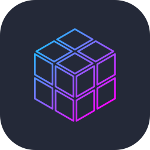
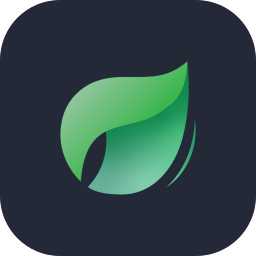
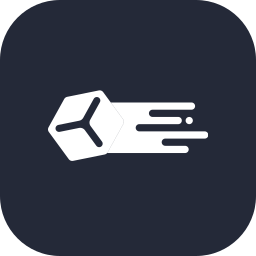
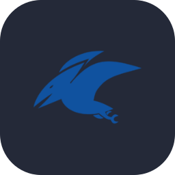

# Hey, i'm Jules 👋

I also go by **infectedware**. I'm originally from France and i've been living in Romania since 2021. I really love it here, even if i miss my family sometimes. I've been making Minecraft stuff since i was 11 and i still enjoy it just as much. I write Paper and Folia plugins, set up and optimize servers, and handle the sysadmin side for a few PvP and SMP networks. I'm still in school, so i'm learning new languages whenever i find the time.

- 🌐 You can find my full [CV / Portfolio](https://infectedware.dev) here
- 💬 You can message me on Discord: `infectedware`
- 📫 Or email me at workinfectedware@gmail.com

## Tech Stack

  
   
  
   
  &nbsp;&nbsp;&nbsp;&nbsp;&nbsp;&nbsp;&nbsp;&nbsp;&nbsp;&nbsp;&nbsp;&nbsp;

## 
